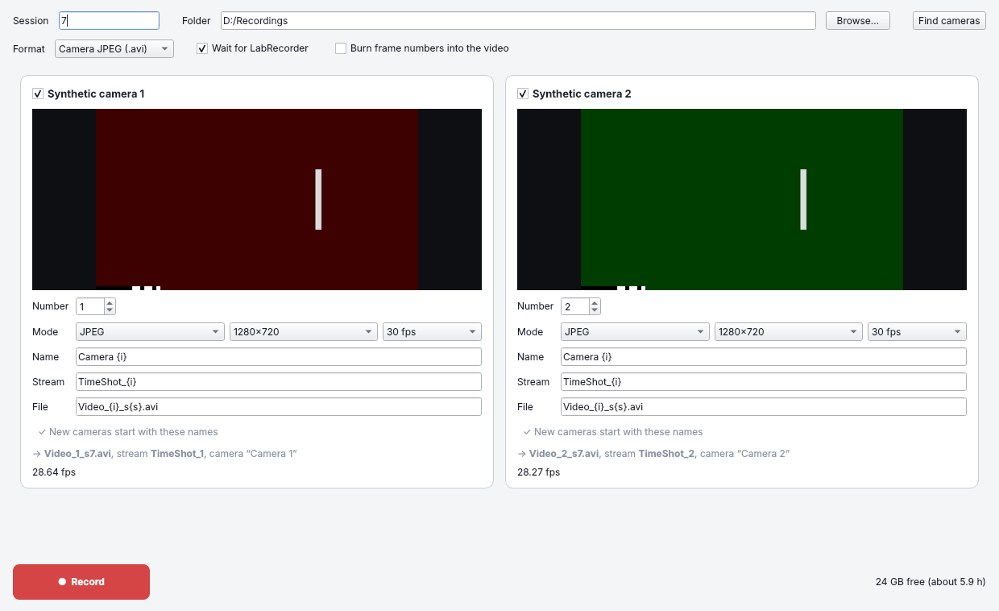

# TimeShot

**TimeShot** records several cameras at once and sends a [LabStreamingLayer](https://labstreaminglayer.org) (LSL) marker for every recorded frame. Recorded with LabRecorder, every video frame then sits on the same clock as your EEG, eye tracking or other streams. [MovieMerger](https://github.com/markspan/MovieMerger) reads both.

TimeShot 2.0 runs on Windows, macOS (Intel) and Linux. It sends the same LSL marker streams and writes the same kind of video files as TimeShot 1.x, so existing recordings and analysis scripts keep working.

<p align="center">
  
</p>

## Download

**Windows:** get `TimeShot-<version>-windows-x64.zip` from the [latest release](https://github.com/markspan/TimeShot/releases/latest), unzip it anywhere and run `TimeShot\TimeShot.exe`. Everything is included, so nothing else needs installing. If Windows SmartScreen warns on the first start, choose *More info* > *Run anyway*.

**macOS and Linux:** run TimeShot from source, see [below](#run-from-source).

## Features

- **The camera's own JPEG frames are written untouched** (`.avi` or `.mkv`): no re-encoding, so identical quality at a fraction of the CPU. Burning each frame's number into the picture is optional.
- **Or H.264 in MP4** (`.mp4`): files about ten times smaller, encoded by the graphics hardware (NVIDIA, Intel, AMD, Apple) if it can, else by the CPU. Without B-frames, so frame N is marker N in every tool, and fragmented, so a recording cut off by a crash stays readable.
- **One process per camera**, so a camera can never delay another camera's markers, or the window.
- **One window**: live previews on camera cards, real camera names, format, resolution and frame rate per camera, name templates with their results shown live, inline warnings, LabRecorder connection status and free disk space.
- **Settings are remembered** per camera, also when cameras come back in another order.
- **A command line** for scripted recordings.

## Usage

1. Start TimeShot. It finds the cameras and shows each one on a card with a live preview. Plugged one in later? Click **Find cameras**.
2. On each card, tick the cameras to record and choose their mode (resolution, frame rate and format). The camera name, LSL stream name and video file name are templates: `{i}` becomes the camera's **Number** and `{s}` the session. Each camera keeps its number, and its other settings, for next time, whatever order the cameras are listed in. **Use these names for new cameras** makes a card's templates the ones a camera seen for the first time starts with.
3. At the top, fill in the session, the folder for the videos and the file format.
4. Click **Record**. TimeShot creates each camera's LSL marker stream; with **Wait for LabRecorder** ticked (the default), recording starts once LabRecorder records all of them. Start LabRecorder's recording now.
5. Click **Stop** to finish. The video files are complete once the **Record** button is back, with a summary of the recording next to it.

TimeShot remembers its settings in a JSON file on this computer: on Windows `%LOCALAPPDATA%\TimeShot\TimeShot\settings.json` (the window's status line shows where). It holds the session, the folder, the two options, every camera's number, mode and name templates, and under `templates` the names a camera seen for the first time starts with. Edit it while TimeShot is closed: TimeShot writes it again as it closes.

Without the window, from a terminal (`TimeShot.exe` on Windows, `timeshot` when run from source):

```bash
timeshot devices                         # the cameras TimeShot finds, and their modes
timeshot devices --details               # ... and why a camera is missing
timeshot record -t 10                    # record every camera for 10 s, once LabRecorder records
timeshot record --file Video_{i}.mp4     # record H.264 instead of camera JPEG; Ctrl+C stops
timeshot record --help                   # everything else
```

## Analysing recordings: MovieMerger

[MovieMerger](https://github.com/markspan/MovieMerger) turns a recording into watchable, synchronised video. Give it LabRecorder's `.xdf` file and TimeShot's video files, and it retimes every video by its own LSL frame markers and places the audio from the XDF file sample-accurately underneath it. It makes one synchronised video per camera and a mosaic of all cameras in one picture, from a desktop app or from the command line. It reads all of TimeShot's formats (`.avi`, `.mkv` and `.mp4`).

## How the timing works

- Each frame's marker is pushed the moment the camera delivers the frame, and LSL stamps it with its own clock right then. TimeShot never sets timestamps itself.
- Each marker carries the frame's index in its video file: frame N of the video always belongs to marker N.
- No recorded frame is ever dropped. If the disk falls more than about two seconds behind, capture waits for it rather than skip frames.
- Each camera's capture runs in a process of its own, and writing the video and drawing the preview run on threads of their own, so none of them can delay the next marker.
- LSL streams exist only while recording (or waiting for LabRecorder); previews send nothing.

## Run from source

With Python 3.12 or newer, in a virtual environment of its own:

```bash
python -m venv .venv
.venv\Scripts\activate    # on Windows; on macOS and Linux: source .venv/bin/activate
pip install -e ".[dev]"
timeshot                  # the desktop app
timeshot devices          # the cameras TimeShot finds, and their modes
```

`timeshot --synthetic 2 ...` replaces the cameras by two synthetic test cameras.

Use a Python from [python.org](https://www.python.org/downloads/) (or your system's), not Anaconda's base environment. Anaconda brings its own, older Qt and ICU libraries, which clash with the Qt that PySide6 brings, so the desktop app fails to start ("DLL load failed while importing QtCore"); and installing TimeShot there can replace packages Anaconda's own tools depend on, such as NumPy.

## Development

`pytest` runs the tests: they record from synthetic cameras through the real recorder processes, LSL streams and video writer, and drive the window offscreen. The **Tests** GitHub Action runs them, with lint (`ruff`) and type checks (`mypy`), on Windows, macOS and Linux.

TimeShot 2.0 has been tested with synthetic cameras and with an Elgato Facecam MK.2; its hardware H.264 encoders have not yet been used for a recording on real graphics hardware. `timeshot devices` shows whether it finds your cameras and their modes, and `timeshot devices --details` why it leaves one out.

### Building the Windows version

To compile the standalone Windows version (a folder with `TimeShot.exe` that runs without Python or anything else installed), run on Windows:

```bat
py -3.12 -m venv .venv-build
.venv-build\Scripts\activate
pip install -r packaging\nuitka\requirements.txt
pip install --no-deps .
python packaging\nuitka\build.py
python packaging\nuitka\smoke_test.py build\TimeShot\TimeShot.exe
```

This makes `dist\TimeShot-<version>-windows-x64.zip`. Nuitka needs a C compiler (Visual Studio or its Build Tools, with "Desktop development with C++"), or downloads MinGW64 itself.

### Releases

The **Build TimeShot 2 (Windows)** GitHub Action (`.github/workflows/build-windows.yml`) builds and smoke-tests the Windows version on every change, and publishes it as a GitHub release when run from the Actions tab with *publish* ticked, or when a `v2.x.y` tag is pushed. Before releasing, bump `__version__` in `src/timeshot/__init__.py` and update `packaging/nuitka/RELEASE_NOTES.md`.

## TimeShot 1.x

The original TimeShot is a C# Windows Forms application (.NET 8, [OpenCvSharp](https://github.com/shimat/opencvsharp), [LSL-CSharp](https://github.com/sccn/liblsl-CSharp)) in `TimeShot/`. Its last release is [1.1.0](https://github.com/markspan/TimeShot/releases/tag/v1.1.0).

To build it, open `TimeShot.sln` in Visual Studio 2022 or later (with the Windows Forms workload and the .NET 8 SDK), or run `pwsh packaging/build.ps1` on Windows to make the release zip. The **Build and release** GitHub Action (`.github/workflows/release.yml`) builds and smoke-tests it, and publishes `v1.x.y` releases.

## License

[GPL-2.0-only](https://opensource.org/licenses/GPL-2.0)

## Acknowledgments

- SCCN for LabStreamingLayer.
- The FFmpeg, PyAV and Qt for Python projects.
- For TimeShot 1.x: the OpenCV community for the C# wrapper, and the MaterialSkin developers.

## Author

**Mark Span**  
GitHub: [@MarkSpan](https://github.com/MarkSpan)
